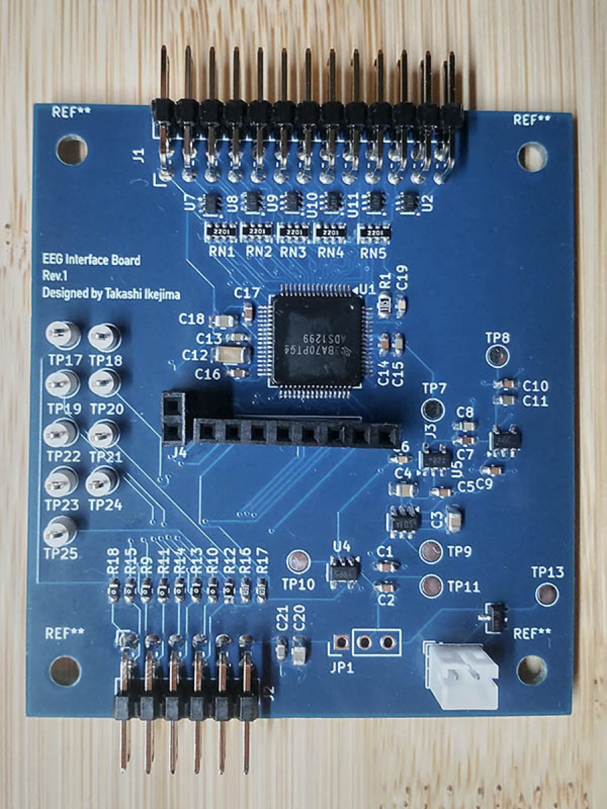
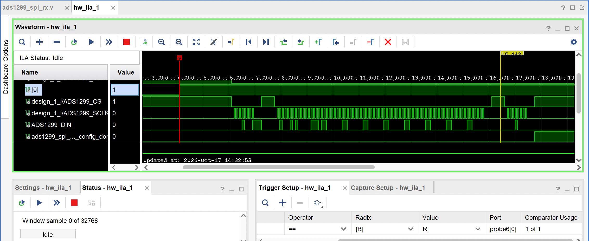

# EEG Platform

A custom multichannel EEG acquisition platform for exploring real-time EEG processing and closed-loop neurotechnology.

## Demo: Real-Time Blink Detection

The system acquires CH1 data from the ADS1299 at 250 SPS, calculates
the peak-to-peak range over 100 ms windows, and turns on an LED when
the range exceeds a threshold of 800 counts.

In this test, a manually performed eye blink produced a transient
increase in the measured range and triggered the LED in real time.

<!-- video -->
https://github.com/user-attachments/assets/f996c3a0-e510-41c0-a689-779db01b0a72


### Example output

```text
CH1 min=-23961 max=-23366 range=595  LED=0
CH1 min=-24158 max=-23965 range=193  LED=0
CH1 min=-24212 max=-22453 range=1759 LED=1  <-- blink detected
CH1 min=-24368 max=-24239 range=129  LED=1
CH1 min=-24333 max=-24226 range=107  LED=1
CH1 min=-24637 max=-24358 range=279  LED=1
```

The third window exceeded the detection threshold:
1759 > 800

and triggered the LED. The LED remains on for approximately 500 ms
after detection, which is why LED=1 continues in the following
windows even though their ranges fall below the threshold.

## Setup

<p align="center">
  
</p>

**Prototype setup: EEG electrodes, custom ADS1299 interface board, and Zybo Zynq-7000.**


<p align="center">
  
</p>

**Hardware connections and major components of the current prototype.**


# Overview
A custom EEG acquisition platform for real-time neural signal measurement and future closed-loop neurostimulation research.

The system is built around a custom ADS1299-based EEG frontend and a Zynq-based processing platform.  
The current focus is reliable multichannel EEG acquisition, real-time data transfer, and system-level validation from analog input to digital processing.

---

## System Overview


The platform consists of:

- **Custom EEG Frontend Board**
  - ADS1299-based multichannel EEG acquisition
  - Input protection
  - On-board power regulation
  - BIAS / common-mode feedback
  - SPI interface to the processing platform

- **Zybo Z7 / Zynq Platform**
  - ADS1299 SPI interface
  - EEG data reception and transfer
  - Optional real-time processing
  - Future stimulation trigger generation

- **Host PC**
  - Visualization
  - Data logging
  - Offline analysis
  - System configuration

The long-term goal is to extend this platform toward a closed-loop architecture in which brain-state information is estimated in real time and used to control non-invasive stimulation.

---

## Custom EEG Frontend

The EEG frontend board is designed specifically for this project.



It is based on the **ADS1299**, an 8-channel, 24-bit analog front end for biopotential measurement.  
The board integrates EEG input protection, analog acquisition, power regulation, and the digital interface required for connection to the Zynq platform.

The KiCad schematic and PCB design files are available in:

```text
hardware/kicad/eeg-frontend/
```

## ADS1299 Initialization

The ADS1299 is configured directly from FPGA logic over SPI.
The initialization sequence was verified on hardware using Vivado ILA.



Vivado ILA capture of the ADS1299 initialization sequence. SPI chip-select, clock, and DIN activity are monitored in the PL, and config_done is asserted after the initialization sequence completes.

### Initialization sequence

| Step | SPI command | Purpose |
|---|---|---|
| 1 | `SDATAC (0x11)` | Stop continuous data mode before register writes |
| 2 | `WREG CONFIG3` | Enable internal reference |
| 3 | `WREG CH1SET..CH8SET` | Configure channel gain and input mode |
| 4 | `RDATAC (0x10)` | Resume continuous data output |


---

## Project Direction

The project is being developed in stages:

1. **EEG frontend design and fabrication**
2. **Multichannel EEG acquisition**
3. **Zynq-based real-time data handling**
4. **Signal processing and brain-state estimation**
5. **Future closed-loop stimulation integration**

The initial objective is not to build a complete clinical neurostimulation device, but to establish a reliable hardware and software platform for real-time EEG-based neural interface research.

---

## Repository Structure

```text
eeg-platform/
├── docs/
│   └── images/
│       ├── eeg-frontend-3d.png
│       ├── eeg-frontend-pcb.png
│       └── system_overview.png
│
├── hardware/
│   └── kicad/
│       ├── eeg-frontend/
│       └── reference_design/
│
└── README.md
```
